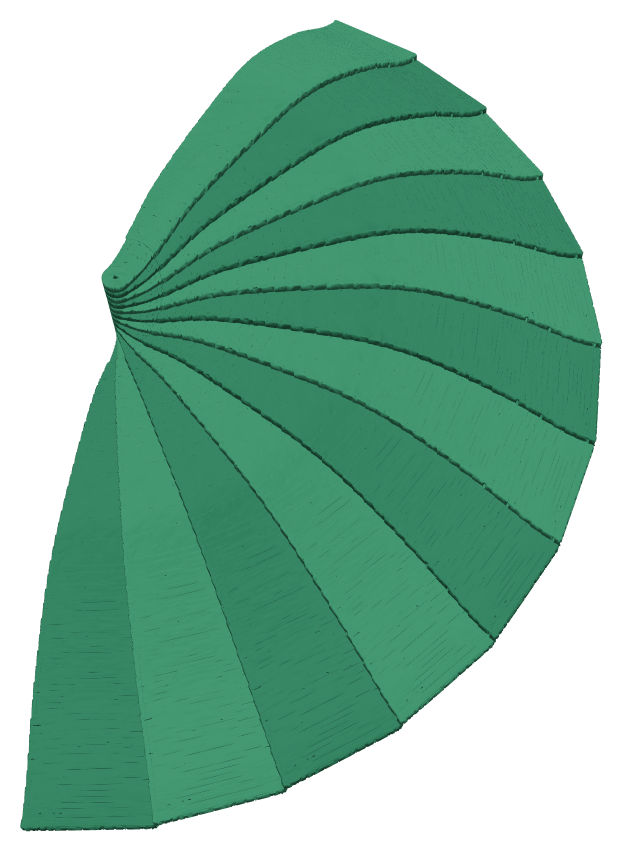
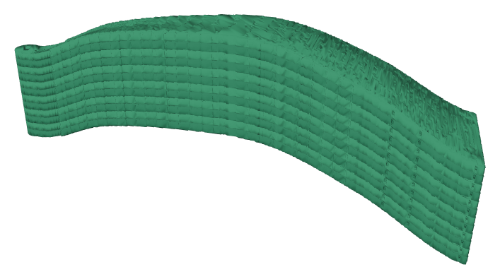
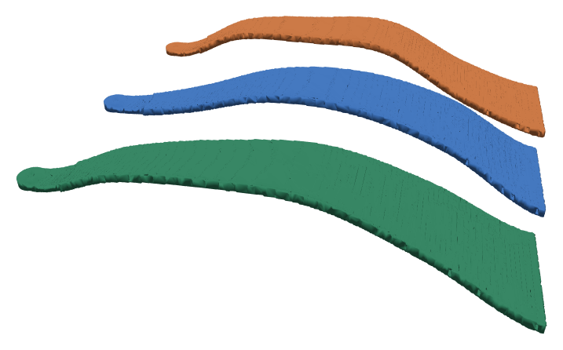

# fan-optimization

A 3D-printed folding hand fan designed by optimization: Bayesian optimization over 3D unsteady CFD picks
the blade shape, then 3D topology optimization hollows each winning blade into a printable part.

<p align="center">
  
  &nbsp;&nbsp;
  
</p>

## Pipeline

1. **Geometry** — CadQuery blade from a 33-parameter codec (rib wave, panel shape, thickness); 12 blades must fold into a ≤ 90 mm stack.
2. **CFD** — SU2 unsteady 3D simulation of the ±40°, 2 Hz stroke; objective `J_fan` = cycle-mean thrust.
3. **Optimization** — BoTorch (qLogNEHVI + TuRBO) over wind ↑, mass ↓, deflection ↓, run across parallel Colab sessions.
4. **Verification** — top designs re-run at fine CFD resolution.
5. **Topology optimization** — per-blade 3D SIMP carves the interior while keeping the aero surface.
6. **Print** — TO density → voxels → marching cubes → on-edge watertight STL + Bambu Studio project.

## Status

**V1 is printed.** Fans of blade designs 00 and 02 are printed in PLA (15 % grid infill, 20 % thinner
than designed, with a hold detent) — see the [print guide](docs/print_guide.md). A **flat control fan**
(blade 00 with its curve taken out, same everything else) is built for the physical tests, which are next:
a blinded feel test and a directional wind test (kitchen scale + card) of curved vs flat vs a store-bought
fan. The print files are generated into `print_ready/` by `scripts/build_print_blades.py`; the older
[release files](https://github.com/clingergab/fan-optimization/releases/tag/v1.0-print) are superseded.

**V2** optimizes wind per unit effort with ML surrogates and GPUs, shape and structure together — see the
[V2 plan](docs/V2_plan.md). It starts by checking the simulation against the printed fans and fixing the
known CFD gaps (wrist pivot, whole fan, physical units) before growing the design space. The V1 campaign
data is in [`data/campaign_trapezoid/`](data/campaign_trapezoid/README.md).

<p align="center"></p>

## Quick start

```bash
conda env create -f environment.yml && conda activate fanopt
pip install -e ".[dev]"
pytest
```

CFD and topology-optimization runs live in [`notebooks/`](notebooks/README.md) (Colab). Design decisions
are in [`docs/adr/`](docs/adr/README.md).

## License

MIT
