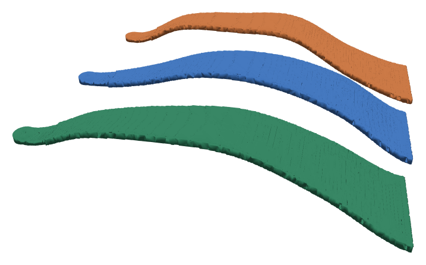

# V1 print guide — Bambu Lab H2C, PETG or PLA

Three optimized blade designs; each fan is 12 identical blades threaded on a Ø3 mm pin. Each design is
printed as its own fan and judged in the blinded A/B feel test against the printed flat baseline.



> **Do not print the `_ribadd` files** (or `_ribadd_clean`, `_supported`, `_raft`, or any project made
> from them). They are a ~0.25 mm skin, not the designed blade: an Aug-7 post-processing step replaced
> every solid region with a hollow shell thinner than the nozzle, and they print as spaghetti. Use the
> rebuilt files below. The image above and the previews in [`docs/models/`](models/) were made from
> the old files and predate the rebuild.

## 1. Files

The print files are too large for the repo (≈ 60 MB STL, ≈ 12 MB 3MF each). They are generated into
`print_ready/` (git-ignored) by `scripts/build_print_blades.py` (§7). They are **not yet** in the
[`v1.0-print` release](https://github.com/clingergab/fan-optimization/releases/tag/v1.0-print), which still
holds the old `_ribadd` files.

| Print file | Role | Edge rib | Folded stack | Pin |
|---|---|---|---|---|
| `P2C_blade_00_2026-11-22_boss-flush_recess-0.35.3mf` | **best wind** — marginal on stress (FOS ≈ 1.9) | 2.0 mm | 79.4 mm | Ø3 × ~49 mm |
| `P2C_blade_02_2026-11-22_boss-flush_recess-0.35.3mf` | **best structure** | 1.5 mm | 78.3 mm | Ø3 × ~48 mm |
| `P2C_blade_03_2026-11-22_boss-flush_recess-0.35.3mf` | **clean** all-rounder | 2.0 mm | 78.8 mm | Ø3 × ~49 mm |

Pin length = the 12 stacked bosses (37.5 / 36.2 / 37.5 mm) + the same ~12 mm for end caps the earlier
60 / 59 / 57 mm pins allowed. The longer pins still work if you already have them.

Print the `.3mf` (Bambu Studio project, H2C settings below). Each has a matching `.stl` (same blade, for
other slicers) and a `.json` report (volumes, mass, checks). "P2C" in the filenames is a historical typo;
the files are correct.

Files are in millimetres, pre-oriented **on-edge** with the leading-edge wall flat on the bed; bbox
≈ 227 × 45 × 51 mm.

**What the blade is:** the topology-optimized (TO) solid, rebuilt directly from the optimizer's own
density on its own tetrahedral mesh — surface within 0.06 mm (median) of the design. The TO left the root
⅔ of the blade solid and carved the outer ~80 mm into a hollow with 0.5 mm-or-thicker aero faces. The
rebuild adds only what the design specified:

- the 0.5 mm frozen aero skin (re-imposed; the TO's per-element density left pinholes along mesh edges);
- the solid hub (r ≤ 20 mm) with a Ø3.0 mm through-bore for the pin;
- the leading/trailing-edge ribs (width in the table), where the TO had carved them away near the tip;
- a 0.6 mm tip-end cap;
- the Ø12 mm pivot boss made **flush with the blade where it joins the boss** — the same thickness
  (3.126 / 3.017 / 3.122 mm for 00 / 02 / 03) at the same height, both faces within 0.1 mm of the blade
  at the boss edge — so neighbouring blades touch with no gap (§4b). The original design spacing
  (4.038 / 3.904 / 3.784 mm) left a 0.65–0.9 mm gap next to the hub;
- the **open/closed hold detent** (§4a) — added after the TO, not part of it.

The hollow is intentional. Under 0.01 % of the area is thinner than the 0.4 mm nozzle.

## 2. Slicer settings (in the `.3mf`)

| Setting | Value |
|---|---|
| Printer / nozzle | Bambu Lab H2C, 0.4 mm |
| Process | 0.20mm Standard @BBL H2C |
| Filament | Generic PETG @BBL H2C 0.4 nozzle (switch for PLA — §2a) |
| Nozzle / bed (PETG) | 255 °C / 70 °C |
| Plate | Textured PEI |
| Walls | 2 loops |
| Infill | **100 % zig-zag** — the TO sized and stress-checked the blade as solid plastic |
| Supports | **off** — on-edge, only ~15–25 mm² per blade faces down |
| Brim | outer only, 8 mm (steadies the tall thin wall) |
| Raft | none |
| Placement | centred in the bed region both H2C nozzles reach (x 25–325 mm) |

Bambu Studio may warn that the object "has floating regions" (00 and 02; it comes and goes between
slices). It flags sub-nozzle slivers on the inside wall of the sealed hollow, each within 0.35 mm of
the wall below, which merge into the wall or are too small to print. Ignore it and keep supports
**off** — supports would grow inside the sealed hollow, where they can never be removed.

## 2a. Material: PETG or PLA

Either filament works with the same print file; only the filament profile changes. Pick it in Bambu
Studio (**Generic PETG @BBL H2C 0.4 nozzle** or **Generic PLA @BBL H2C 0.4 nozzle**) before slicing.
The profile sets the nozzle/bed temperatures and cooling. The other settings in §2 stay the same.

The topology optimization and its stress checks used **PETG** properties (`schema.py`). PLA is not
re-optimized; these are typical-datasheet trade-offs, not measured on our prints:

| | PETG (as designed) | PLA |
|---|---|---|
| Density | 1.27 g/cm³ | 1.24 g/cm³ (≈ 2 % lighter) |
| Stiffness | baseline (FDM 1.3 GPa in-plane) | roughly 1.5–2× stiffer → less flex |
| Failure | bends before breaking | stronger but brittle — snaps on a drop or a hard fold |
| Heat | softens ≈ 70–80 °C | softens ≈ 55–60 °C (a hot car can warp it) |
| Flexing parts (the blades press and flex, §4a–4b) | suited | likely to crack or fatigue |

Rebuilt-blade masses (`print_ready/P2C_blade_0N_2026-11-22_boss-flush_recess-0.35.json`, solid volume × filament density):

| Design | Volume | PETG blade / 12-blade fan | PLA blade / 12-blade fan |
|---|---|---|---|
| 00 | 17.25 cm³ | 21.9 g / 263 g | 21.4 g / 257 g |
| 02 | 16.67 cm³ | 21.2 g / 254 g | 20.7 g / 248 g |
| 03 | 16.74 cm³ | 21.3 g / 255 g | 20.8 g / 249 g |

All are under the 300 g fan cap. To have the build report the mass in a given filament, pass
`--material petg|pla` to `scripts/build_print_blades.py` (default `petg`). This changes only the
reported mass; the `.3mf` keeps the template's filament profile.

## 3. Estimates

Bambu Studio CLI slice of each `.3mf` as shipped (H2C, Generic PETG, one blade per plate):

| Design | Time per blade | Filament per blade | 12 blades (one at a time) |
|---|---|---|---|
| 00 | 1 h 35 m | 24.0 g | ~19 h, ~288 g |
| 02 | 1 h 35 m | 23.4 g | ~19 h, ~281 g |
| 03 | 1 h 31 m | 23.4 g | ~18 h, ~280 g |

Slicer filament is ~2 g above the blade's own mass: the brim (0.9 g) and the H2C PETG profile's flow
ratio (0.97 vs the P2S's 0.95) account for most of it. 254 layers at 0.20 mm. Several blades per plate
fit on the H2C bed and save heat-up/homing time per blade, but have not been sliced.

## 4. Assembly (per fan)

1. Peel the brim; deburr the bore ends and the brim edge. The detent bumps print just above the brim
   (§4a): if one fused to the brim, trim it free and keep its dome intact.
2. The Ø3.0 mm bore is exactly the pin diameter (no clearance), and printed holes usually come out a
   little small: ream to Ø3 mm, or use a Ø2.9 mm rod for a light sliding fit.
3. Thread 12 blades on a Ø3 mm steel/brass pin (length per §1), **all the same way up** — bumps all
   facing the same way — so they nest in a clean z-stack and each bump meets the recesses above it.
4. Cap both ends (cap / washer / push-nut) with light axial preload. Do not over-tighten: the blades
   already press on each other (§4b) and must still flex 0.3 mm apart for the detent to click.

## 4a. Open/closed hold detent

Each blade carries 5 small domes (bumps) on its top face along the overlapping edge, 80–120 mm from the
pin, and 10 shallow dimples (recesses) in its underside. Each bump rides in the underside of the blade
above it:

- **Folded:** each bump sits in the blade above's *closed* recess, right over it.
- **Open:** turning the blade above one 13.3° pitch slides the bump 19–28 mm into its *open* recess.
- **The hold:** the blades touch at every seat (§4b), and each bump stands 0.3 mm proud of the blade
  face, so the blade above must flex up 0.3 mm to slide off a recess. The blade's own flex is the spring.

Every seat on all three designs: bump **0.30 mm** tall, 1.9 mm across, cut from a 1.6 mm-radius sphere
(the same dome shape as the first printed bumps, which were ~1 mm tall because they had to cross the old
gap). Recess **0.35 mm** deep, ~2.1 mm across — 0.05 mm of room under a seated bump and ~0.1 mm around
it, so the bump seats fully without play (extra depth would add rattle, not hold: the hold is set by
the 0.3 mm the bump must climb). At least 2.8 mm of blade is left under a recess. Sizes are measured on
each blade's own surface at each seat (`detent.seats` in the `.json` report).

**The detent works in one opening direction only.** With the pin at the bottom, the fan opens **to the
right**: the front blade (the one you push) swings right. This holds whichever face you look at. Check
it on the first pair (§5) before printing the rest; the other direction needs a rebuild with
`--deploy-direction 1` (§7).

The 0.3 mm overlap is a first guess at the hold strength, not a tested value. If the pair's hold is too
weak or too stiff, rebuild with a different `DetentSpec.interference_m` (`src/fanopt/geometry/blade_detent.py`).
A detent on the pivot boss is not possible (13.3° × 6 mm boss ≈ 0.8 mm of travel, smaller than any bump),
which is why it sits out on the blade.

## 4b. Blades touch, and press where they are thicker

The boss sets how far apart neighbouring blades sit on the pin. It is now as thick as the blade where the
blade joins it, so there is no gap next to the hub. The blade is not the same thickness everywhere — it
thickens toward the tip ribs — so where it is thicker than the boss, each blade pushes its neighbour
away and both flex:

| Design | Thickest point | Press when folded/open | Tip corners mid-swing |
|---|---|---|---|
| 00 | 3.64 mm | up to 0.51 mm | up to ~0.77 mm |
| 02 | 3.50 mm | up to 0.49 mm | up to ~0.82 mm |
| 03 | 3.38 mm | up to 0.26 mm | up to ~0.35 mm |

The blades are flexible, so this costs some friction when opening (set by the end-cap preload), not
strength. It leaves far smaller gaps for air to leak through than the original spacing
did, and the 12-blade folded stack is 7–10 mm thinner.

## 5. Before committing 36 blades

1. Print **one** blade: check the first layer runs the full length and the tip skins close.
2. Print a **pair** + pin: check that the blades nest when folded, that the fan opens to the right
   (§4a), that the bumps seat fully in the recesses, and that it clicks into the open and closed
   positions and holds there without forcing.
3. Print a few more and stack them: the blades press on each other (§4b) — check that opening still
   feels smooth with several on the pin.

## 6. Known V1 limitations

- **Flex:** the TO minimized compliance only, so it left the outer third hollow with no internal webs
  (and its gray, not-fully-converged elements there were printed as void). The blades will flex. V1.5 fix:
  re-run TO with a stiffness objective + buckling constraint (`V2_backlog.md`).
- **Ranking was flex-blind:** designs were ranked on rigid-blade CFD (ADR-0008); the feel test judges
  the real, flexing blade.
- **Hub root is un-optimized** (the TO clamped a retired 20 mm hub band; the rebuild fills it solid) —
  sound for V1, fixed in V1.5 (`V2_backlog.md`).

## 7. Rebuilding the print files

The TO densities and campaign shards are recovered from Drive into `print_ready/drive_recovery/`.

1. Export a Bambu template for the printer/filament (Bambu Studio writes every printer setting):

   ```
   python3 scripts/make_bambu_template.py --model <any .stl/.3mf> \
       --machine "Bambu Lab H2C 0.4 nozzle" --process "0.20mm Standard @BBL H2C" \
       --filament "Generic PETG @BBL H2C 0.4 nozzle" --out print_ready/rebuild/H2C_petg_template.3mf
   ```

2. Build each blade (`--rib-width-mm` 2.0 for 00 and 03, 1.5 for 02):

   ```
   python3 scripts/build_print_blades.py --name 00_ffe19f9e3e7fa81ba847bbe8 --rib-width-mm 2.0 \
       --shards print_ready/drive_recovery/campaign_trapezoid --to-dir print_ready/drive_recovery \
       --out print_ready/P2C_blade_00_<YYYY-MM-DD>_<what-changed>.stl \
       --template print_ready/rebuild/H2C_petg_template.3mf
   ```

   Every build gets a new, dated name: the script refuses to overwrite an existing `.stl`, `.json` or
   `.3mf`, so earlier versions (including ones already printed) are always kept.

   Design names: `00_ffe19f9e3e7fa81ba847bbe8`, `02_248e298991dfd83a3f7bdfe0`,
   `03_1be42b2b86422ad222fb548a`. Each build takes ~5 min (the three run in parallel fine).

   The detent is on by default: `--detent-seats 5` (`0` builds the blade without it) and
   `--deploy-direction -1` (fan opens to the right, §4a; `1` reverses it).
